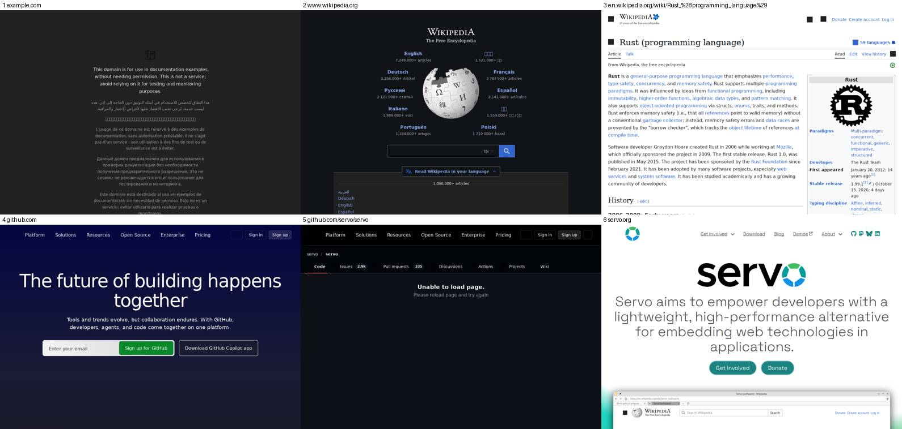
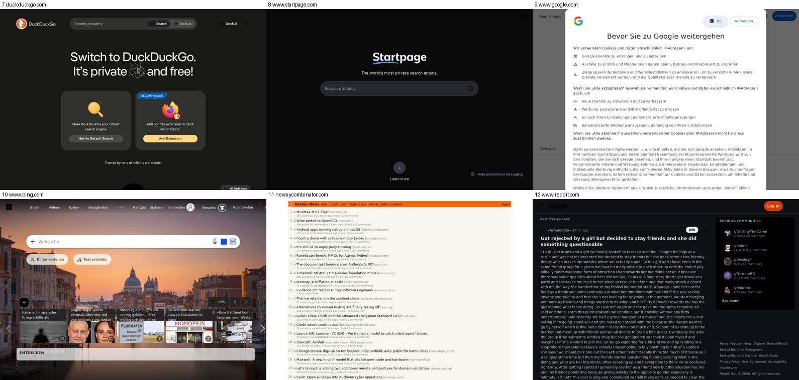
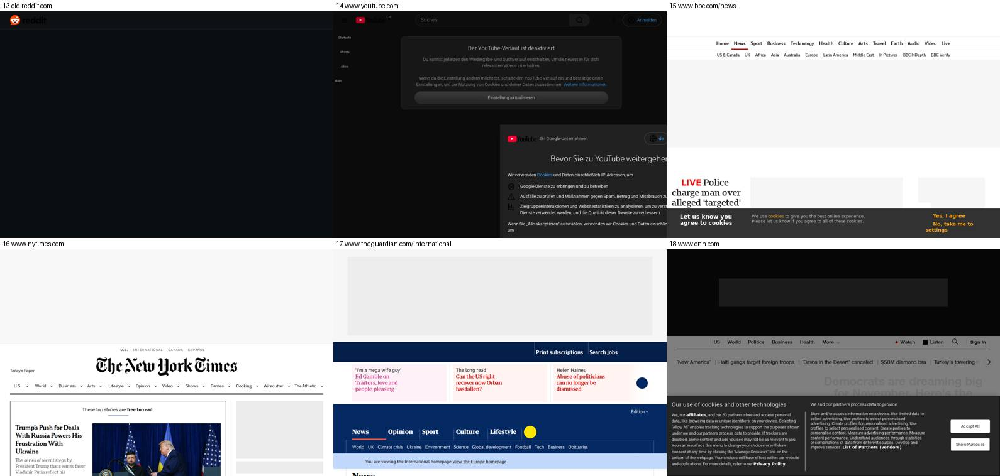
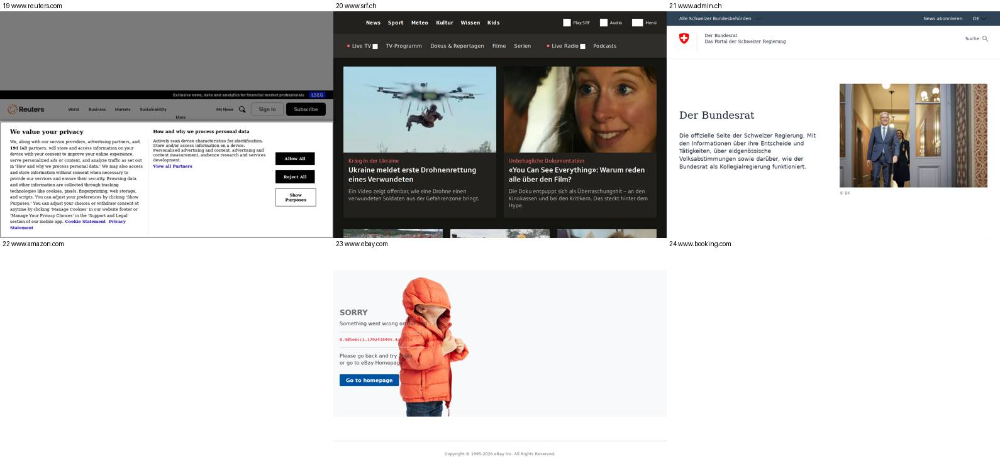
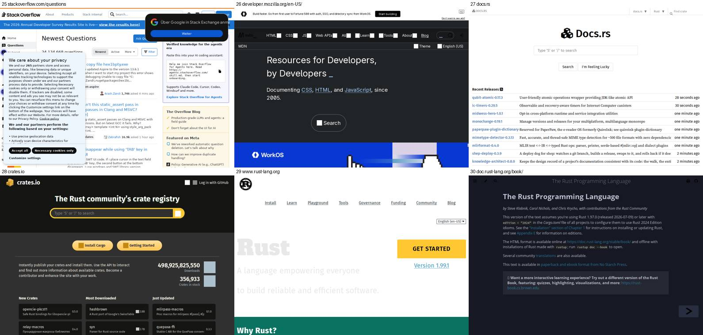
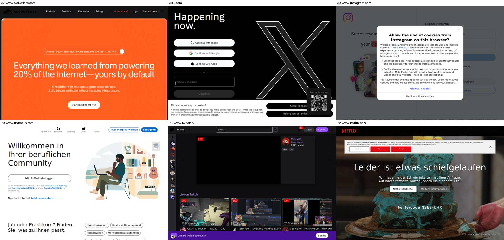
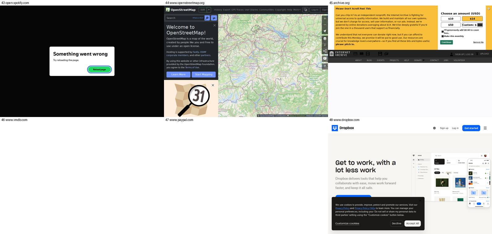
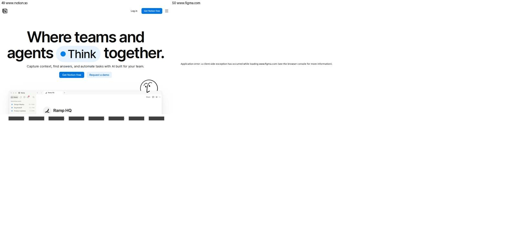

# Servo compatibility runs

Compatibility runs of the experimental Servo web view
([issue #65](https://github.com/freewright-dev/BrowseCraft/issues/65)): 50
websites opened in BrowseCraft with Servo, looking at what the first screen
shows. They measure where the slice stands; they are not a pass/fail gate by
themselves.

## Current integration: Servo 0.7

The historical runs below used Servo 0.6. The current integration uses
Servo 0.7, which includes the upstream fix for an `IntersectionObserver`
walk that never advanced past boxless ancestors (`display: contents` and
shadow slots): [Servo #47693](https://github.com/servo/servo/pull/47693).
A debugger captured this loop on Notion; a local page reproduces the hang
without depending on a live site's content.

Two compatibility policies differ from run 2:

- Web Animations remains at Servo's disabled default. Enabling the incomplete
  API leaves Figma's hero at opacity zero; disabling it lets Figma use its
  working fallback. CSS animations and `requestAnimationFrame` are separate.
  Sites requiring `Element.animate()` without a fallback, including parts of
  YouTube, remain unsupported.
- Servo webpages prefer light mode, independently of the chrome theme.
  Servo currently resolves default `CanvasText` to a pale color on pages
  with white backgrounds even without dark-mode opt-in
  ([Servo #48630](https://github.com/servo/servo/issues/48630)). This avoids
  unreadable pages such as Rust's homepage without overriding author CSS.
  Restore theme propagation when the upstream default-color bug is fixed.

`IntersectionObserver`, adopted stylesheets and `crypto.getRandomValues()`
remain enabled; `crypto.subtle` remains disabled for the security reason in
[dependencies.md](dependencies.md). Servo 0.7's `show()`/`hide()` now also
control throttling. Its DOM Page Visibility implementation is still incomplete:
documents report visible even when hidden. This is not a lifecycle fix in
BrowseCraft, and no JavaScript visibility override is injected.

With a display available, run `python3 tools/servo-compat/smoke.py` after
building with `--features servo`. It checks real observer callbacks through
boxless ancestors and shadow slots, an offscreen negative control, timer
progress and readable default text. It also checks cosmetic filtering of
static/dynamic elements, host-scoped exceptions, negated hosts, cross-origin
frames and navigation between hosts with different rules, using temporary
filter lists and no remote sites. An external 15-second watchdog catches
script-thread hangs; the log and raw frame go to `target/servo-smoke`.

Cosmetic filtering uses Servo's per-document user scripts, including subframes,
and the same compiled filters as the other backends. Matching `#@#` exceptions
are subtracted after matching the document's host. CSS hides later-added
elements without a mutation observer. Native resource filtering still owns
network blocking; no fetch/XHR wrappers are installed in Servo. User scripts
run asynchronously, so an initial flash of unfiltered content is possible.
Filter lists are loaded once at browser startup: restart after changing them.
There is no live filter-reload setting. Existing parser limits still apply
(including no procedural cosmetic rules or scriptlets); this is not full uBO
rule compatibility, and pages can remove injected styles.

## Historical runs

- **Run 1** (2026-10-19) used Servo's default build features and preferences.
- **Run 2** (2026-10-20) added the fixes found by analysing run 1:
  - Servo's `webcrypto` cargo feature, for `crypto.getRandomValues()`;
  - the experimental preferences for `IntersectionObserver`,
    `document.adoptedStyleSheets` and `Element.animate()`;
  - `crypto.subtle` kept off (see [dependencies.md](dependencies.md)).

## Method

- **Build:** BrowseCraft debug build with `--features servo` (Servo 0.6.0 LTS).
- **Machine:** WSL2 Ubuntu 24.04 (WSLg display, Mesa software rendering),
  16 cores, 24 GB of memory.
- **Window:** 1060×722 page area, dark theme.
- **Per site:** 30 seconds. `BROWSECRAFT_SERVO_TRACE` logged load progress,
  and `BROWSECRAFT_SERVO_FRAME` saved Servo's newest frame.
- **Rating:** done by eye from the saved frame.
  - *Works:* the page renders as intended; small icon glitches are allowed.
  - *Partial:* usable but visibly incomplete.
  - *Broken:* blank, or the site's own error page.
- **Not covered:**
  - Interaction: clicking, typing, scrolling and video playback. Media is
    built without GStreamer, so video can't play.
  - Logged-in pages.
  - Release-build timing.
- **Sites change from day to day.** A difference between runs can come from
  the site rather than the browser (see "Changes between runs" below).
- **Missing glyphs:** WSL has no fonts for some scripts (CJK, Devanagari), so
  a few lines show boxes. That is the test machine, not Servo.

Rerun with [tools/servo-compat/run.sh](../tools/servo-compat/run.sh); the site
list is [tools/servo-compat/sites.txt](../tools/servo-compat/sites.txt).
`RUST_LOG=error` adds Servo's own errors, including uncaught page exceptions,
to each site's log.

## Summary

| | Run 1 | Run 2 |
|---|---|---|
| Works | 33 | 38 |
| Partial | 6 | 7 |
| Broken | 11 | 5 |
| Crashed or hung the browser | 0 | 0 |
| Reached "load complete" within 30 s | 47 | 44 |
| Median load time | 1.5 s | 1.3 s |
| 90 % loaded within | 10 s | 4.8 s |
| Slowest | 20.9 s | 11.5 s |

Load time is when Servo reported the page complete, counted from Servo's
start (debug build).

Patterns:

- **Cookie banners and consent dialogs work** on almost every site that shows
  one.
- **Icons often show as solid squares.** This affects small icons on
  Wikipedia, SRF, MDN and crates.io, which suggests icons drawn with CSS
  masks or SVG are not supported yet.
- **Most of what still fails** is a site turning Servo away (eBay), a Servo
  bug (PayPal), or a page that comes out blank without any script error
  (Startpage, Reddit, Microsoft).

## Why sites failed in run 1

The broken and partial sites were opened again with
`BROWSECRAFT_SERVO_TRACE=1 RUST_LOG=error`. That logs page console errors,
uncaught exceptions and Servo's own errors. The pages themselves download and
parse within 0.4–3 s, so networking and HTML parsing were not the problem.
What failed was the page's JavaScript, mostly on a web feature that was
missing in that build.

| Cause | Sites | Error seen | Status in run 2 |
|---|---|---|---|
| `crypto.getRandomValues()` missing | BBC, Amazon, Booking, Spotify, IMDb, Figma, Microsoft | `crypto.getRandomValues() not supported` / `crypto is not defined` | Fixed by Servo's `webcrypto` feature. BBC, Amazon, Booking and IMDb work; Spotify and Figma are partial. IMDb still logs `Q.subtle is undefined`, because `crypto.subtle` stays off |
| `IntersectionObserver` missing | Netflix, GitHub repository page | `IntersectionObserver is not defined` | Fixed by `dom_intersection_observer_enabled`; both work |
| `document.adoptedStyleSheets` missing | archive.org, GitHub repository page | `e.adoptedStyleSheets is undefined` | Fixed by `dom_adoptedstylesheet_enabled`; archive.org works |
| `Element.animate()` missing | YouTube | `v.hostElement.animate is not a function` | Error gone with `dom_web_animations_enabled`; YouTube still shows only its consent page |
| JavaScript error during start-up | GitHub repository page | `can't access lexical declaration 'p' before initialization` | Gone; the page works |
| Servo panics | PayPal | `internal error: entered unreachable code: Removed @font-face that was not previously present` (`servo-script-0.6.0/dom/css/fontfaceset.rs:184`) | Still broken; an upstream bug. The browser keeps running, but the page never finishes and `notify_crashed` is not called |
| The site turns away unfamiliar browsers | Stack Overflow (Cloudflare bot check), old.reddit (redirect to `/login/?reason=lor2`), eBay (error page) | none | Stack Overflow passes the check in run 2 and works; old.reddit and eBay are unchanged |
| Layout or drawing differences, no script error | rust-lang.org, nodejs.org | none | Unchanged; upstream rendering gaps |

## Changes between runs

Four sites did worse in run 2: Startpage and Reddit (blank, dark), Notion
(partial) and Microsoft (blank). None of them logged a script error.

For Startpage and Reddit, each new setting was turned off on its own and
tested again, and the site still came out blank every time:

- Web Animations;
- `IntersectionObserver`;
- `adoptedStyleSheets`;
- `crypto.subtle`, tried switched on.

The build from before any of these changes (commit `2b6cdb6`) now shows them
blank too, so the change comes from the sites between the two runs, not from
the new settings. Notion and Microsoft have not been isolated yet.

## Results

| # | Site | Run 1 | Run 2 | Load (s), run 2 | Notes (run 2) |
|---|---|---|---|---|---|
| 1 | example.com | Works | Works | 0.58 | |
| 2 | www.wikipedia.org | Works | Works | 0.88 | |
| 3 | en.wikipedia.org/wiki/Rust_(programming_language) | Works | Works | 4.64 | Small icons render as squares |
| 4 | github.com | Works | Works | – | Never reported complete |
| 5 | github.com/servo/servo | Broken | **Works** | 2.41 | |
| 6 | servo.org | Works | Works | 0.81 | |
| 7 | duckduckgo.com | Works | Works | 0.77 | |
| 8 | www.startpage.com | Works | **Broken** | – | Blank; also blank with the run 1 build (site change) |
| 9 | www.google.com | Works | Works | 1.30 | Consent page |
| 10 | www.bing.com | Works | Works | 1.86 | |
| 11 | news.ycombinator.com | Works | Works | 1.29 | |
| 12 | www.reddit.com | Works | **Broken** | 0.30 | Blank; also blank with the run 1 build (site change) |
| 13 | old.reddit.com | Partial | Partial | 0.98 | Redirected to a login page |
| 14 | www.youtube.com | Partial | Partial | 5.86 | Consent dialog and page frame only |
| 15 | www.bbc.com/news | Broken | **Works** | 1.49 | Some image slots still empty |
| 16 | www.nytimes.com | Works | Works | 9.48 | Empty ad slot at the top |
| 17 | www.theguardian.com/international | Works | Works | – | Never reported complete |
| 18 | www.cnn.com | Works | Works | 4.45 | Consent dialog |
| 19 | www.reuters.com | Works | Works | 2.41 | Consent dialog |
| 20 | www.srf.ch | Works | Works | 3.76 | Small icons render as squares |
| 21 | www.admin.ch | Works | Works | 4.65 | |
| 22 | www.amazon.com | Broken | **Works** | 2.73 | |
| 23 | www.ebay.com | Broken | Broken | 0.50 | eBay error page |
| 24 | www.booking.com | Broken | **Works** | 3.63 | Sign-in prompt over the page |
| 25 | stackoverflow.com/questions | Broken | **Works** | 4.90 | Passes the Cloudflare check |
| 26 | developer.mozilla.org/en-US/ | Works | Works | 0.71 | Small icons render as squares |
| 27 | docs.rs | Works | Works | 0.75 | |
| 28 | crates.io | Works | Works | 1.11 | Small icons render as squares |
| 29 | www.rust-lang.org | Partial | Partial | 0.73 | Hero text barely visible |
| 30 | doc.rust-lang.org/book/ | Works | Works | 0.43 | |
| 31 | www.python.org | Works | Works | 0.49 | |
| 32 | nodejs.org | Partial | Partial | 0.94 | Heading drawn on a white box |
| 33 | www.w3.org | Works | Works | 0.36 | |
| 34 | www.mozilla.org | Works | Works | 1.38 | Logo artwork glitch |
| 35 | www.apple.com | Works | Works | 0.84 | |
| 36 | www.microsoft.com | Partial | **Broken** | 0.65 | Blank; its consent script returns 403 |
| 37 | www.cloudflare.com | Works | Works | – | Never reported complete |
| 38 | x.com | Works | Works | 2.35 | Login page and consent banner |
| 39 | www.instagram.com | Works | Works | 6.09 | Consent dialog |
| 40 | www.linkedin.com | Works | Works | 0.95 | |
| 41 | www.twitch.tv | Works | Works | 11.48 | Player area black (no media support in this build) |
| 42 | www.netflix.com | Broken | **Works** | 2.48 | Consent banner and sign-up page |
| 43 | open.spotify.com | Broken | **Partial** | 1.31 | App frame with placeholders |
| 44 | www.openstreetmap.org | Works | Works | 0.88 | Map tiles load |
| 45 | archive.org | Partial | **Works** | 1.84 | |
| 46 | www.imdb.com | Broken | **Works** | 4.83 | |
| 47 | www.paypal.com | Broken | Broken | – | Blank; Servo panics (upstream bug) |
| 48 | www.dropbox.com | Works | Works | 3.82 | |
| 49 | www.notion.so | Works | **Partial** | – | Hero section missing; not yet isolated |
| 50 | www.figma.com | Broken | **Partial** | 2.19 | Cookie dialog, body blank |

## Screenshots

The first screen of each site in run 2, reduced to half size:

